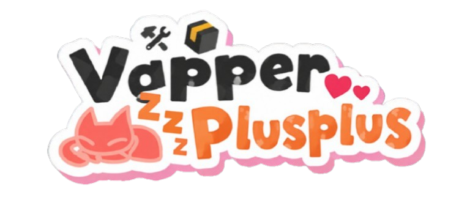

<p align="center">
  
</p>

<h1 align="center">😼 Yap++ 😼</h1>

<p align="center">
  The cutest client modification for <a href="https://www.yapin.gg">Yappin'</a>, rebuilt on
  <a href="https://github.com/yapin-js/yapin.js-client">yapin.js-client</a>.
</p>

<div align="center">

[](https://choosealicense.com/licenses/mit/)
[](https://github.com/yapin-js/yapin.js-client/releases/tag/v0.1.6)

</div>

---

Yap++ used to be an Electron app of its own: a window wrapping a `<webview>`, a `main.js` that read
`plugins/*.js` off disk, concatenated them, and injected the lot with `executeJavaScript`, plus a
hand-written settings panel bolted into Yappin's nav.

It is now a **client app** built with the yapin.js-client framework. The framework installs itself
into the Yappin' desktop app you already have and brings the plumbing — the plugin lifecycle,
settings, pages, themes, badges and an installer — so Yap++ is only the parts that make it Yap++:
fourteen plugins, their art, and a Credits page.

## Building it

```sh
npm install
npm run dev      # build, install into the Yappin' desktop app, and reload on every save
npm run build    # dist/: setup .exe, installer zip, userscript and payload
npm test         # start every plugin in a headless browser and check what it does
```

`npm run build` writes:

| File | What it is |
| --- | --- |
| `dist/ypp-<version>-setup.exe` | The Windows installer. This is the one to share. |
| `dist/ypp-<version>-installer.zip` | The installer for macOS and Linux. |
| `dist/ypp.user.js` | The web version, for Tampermonkey or Violentmonkey. |
| `dist/payload/` | What actually gets installed. |

Building the `.exe` needs [NSIS](https://nsis.sourceforge.io) on the machine you build on;
everything else works without it (`npm run build -- --no-installer`).

## What's in here

```text
yapin-client.config.js   name, pages, plugin and theme options, installer
src/index.js             the Credits page and the About rows
src/shared/              helpers plugins share: Yappin's session, channel and socket
src/assets/              badge data, and images.json (art as data URLs)
plugins/                 one file per plugin
themes/                  the Yap++ pink theme
icons/                   .svg files, usable by name (icons/ypp.svg -> icon: 'ypp')
assets/                  the original art, and the installer's logo
installer/               what the installer page says and looks like
scripts/build-assets.mjs turns assets/ into src/assets/images.json
test/smoke.mjs           starts every plugin against a mock Yappin' page
```

## The plugins

All fourteen are off until you turn them on, except Staff Badge. Each one has its own settings on
the Plugins page, which is where the old **Yap++ Settings** panel went.

| Plugin | | New in the rebuild |
| --- | --- | --- |
| **Staff Badge** | Badges for contributors, helpers and a few people by name. | Drawn by the framework, which reads the user id off React. No more wrapping `fetch`, sniffing your token or backfilling from Supabase. |
| **Fake verified** | A verified badge on your own name, only on your screen. | No longer needs Staff Badge turned on. Can badge any id. |
| **MessageLogger** | Deleted messages turn red instead of vanishing. | Now remembers messages loaded from history, so deleting an older message works too. Three settings: keep on screen, announce, list. |
| **Character Counter** | How much you've typed, above the composer. | Updates when you type instead of ten times a second. The amber and red thresholds are settings. |
| **SilentTyping** | Never sends a typing frame. | |
| **Double Click Reply** | Double click to reply, or to edit your own. | |
| **Anonymised filenames** | Random names for files you upload. | The file types are a list setting rather than a hand-built tag editor. |
| **Custom Background** | A picture behind Yappin'. | Uses Yappin's colour variables, so light mode still works. The old "Custom CSS theme" box is the framework's Custom CSS, on the Themes page. |
| **Draft Saver** | Keeps unsent messages per channel. | Stored in Yap++'s own storage, pruned to the last 50, and no longer cleared when somebody else posts. |
| **Oneko** | A cat follows your mouse. | The sprite sheet is bundled, so it works offline. |
| **Custom voice messages** | Send an audio file as a voice message. | |
| **ImageSearch** | Right-click an image to search for it. | Built as elements rather than HTML strings, and you choose which engines appear. |
| **SIXSEVEN** / **Im a sigma** | Add `67`, or `(I'm a sigma)`, to everything you send. | Both can run at once. |

Plugins no longer register themselves with `window.PluginHost`. A plugin is a file in `plugins/`
whose default export describes it:

```js
import { definePlugin } from 'yapin.js-client/runtime';

export default definePlugin({
  id: 'my-plugin',              // lowercase, digits and dashes
  name: 'My plugin',
  description: 'What it does.',
  settings: { loud: { type: 'switch', label: 'Be loud', default: false } },
  styles: ({ loud }) => (loud ? '.msg { font-weight: 700; }' : ''),
  start(ctx) {
    ctx.observe('.msg', (message) => {
      /* … */
    });
  },
});
```

Anything registered through `ctx` — styles, listeners, timers, observers, patches, badges, pages —
is undone when the plugin stops, so most plugins need no `stop()`. The full API is in
[`node_modules/yapin.js-client/docs/plugins.md`](https://github.com/yapin-js/yapin.js-client/blob/main/docs/plugins.md).

## The art

Badges want a `data:` or `https:` icon, and the bundler inlines text and JSON but not images. So
`npm run assets` reads `assets/`, downscales each picture to the size it is actually drawn at, and
writes them as data URLs into `src/assets/images.json`, which is committed. 589 KB of PNGs becomes
52 KB of data URLs, and nothing is fetched to draw a badge.

Re-run it after changing anything in `assets/`. It needs no dependencies: it decodes, box-filters
and re-encodes PNGs with `node:zlib`.

Who gets which badge is [`src/assets/badges.js`](src/assets/badges.js) — add an id to
`CONTRIBUTORS`, `HELPERS` or `PERSONAL`.

## Contributing

Same rules as always:

* **No** API calls to anywhere except image-hosting services and Yappin's own Supabase.
* **No** raiding or spamming plugins.
* **No** plugins that break Yappin's terms.
* **No** plugins that could harm anyone's computer.

Run `npm test` before opening a pull request. It starts every plugin against a page with Yappin's
markup and checks that each one does its job and cleans up after itself.

## License

[MIT](LICENSE). Yap++ is unofficial, and is not made, supported or endorsed by Yappin'.
